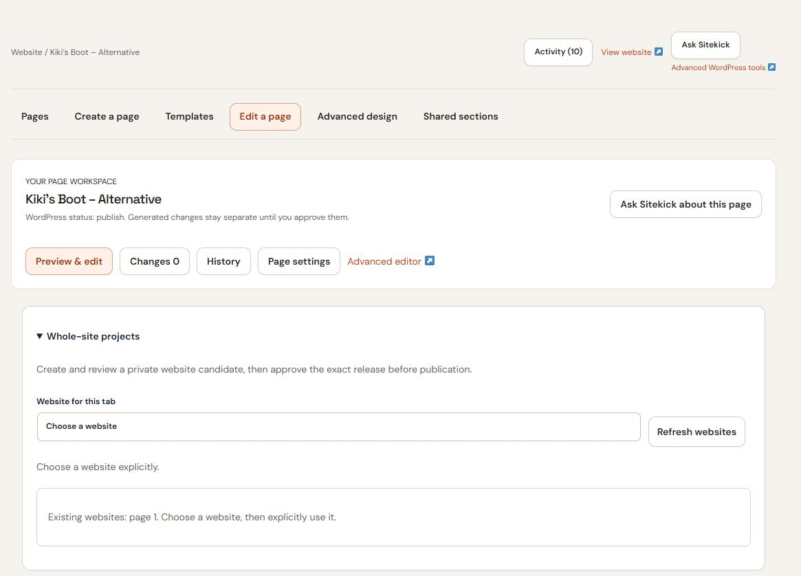

# Whole-site projects

Use **Whole-site projects** when you need a coordinated website candidate. For a small edit to one existing page, [Your Sitekick](your-sitekick-conversations.md) or the [page workspace](review-publish-and-recover.md) is usually the direct route. These are CMS features; they do not require the unreleased Studio product.

Whole-site controls appear when enabled for the installation and authorized for your account. Website creation also requires an available website slot. Current plan, billing access, credits and permissions still apply.

## Select the website before planning

Under **Website for this tab**, explicitly choose the intended website. Use **Refresh websites** if necessary. An owned existing website may offer **Use this website** before it is registered for this workflow. Selection alone does not import, regenerate or publish the website.

*The expanded Whole-site projects controls let you choose the website for this tab.*

Each saved job retains its original website. Switching the dropdown does not move an outstanding job to the new selection. Check the target above generation, preview and publication controls.

## Plan, generate and review

1. Fill in **Plan your website** with approved business facts, audience, visitor action and design family. Choose **Review blueprint**.
2. Review every page route, content and shared style. Use **Save blueprint / refinement**, then **Approve blueprint revision** for the intended revision.
3. Choose **Review generation estimate**. Read the credit context before **Generate private candidate**. The estimate is planning guidance, not an exact final charge or a guaranteed reservation ceiling.
4. Use **Refresh status** to follow generation. When complete, choose **Open private preview** and check each page. Private previews can require your current WordPress login and authorization.
5. Use **Refine this release** if you want another candidate. Review the changed blueprint and a fresh estimate before generating again.
6. Choose **Review publication**, inspect the exact release and impact, then **Approve this exact release**. Choose **Publish approved release** to publish the approved candidate.

Approving a blueprint starts neither generation nor publication by itself. An approval belongs to an exact release; a changed candidate needs its own review. Custom domains need their separate domain, DNS and ownership setup.

## Update an existing WordPress website

Where available, **Update this existing website** lets you explicitly select existing pages and save a coherent update plan. Approve the plan revision, review its generation estimate and generate private page alternatives. Inspect the original and staged previews for every selected page before **Open exact WordPress review** and **Approve these exact native page updates**.

Existing-page updates apply sequentially. Earlier approved pages may already be live while later pages are still processing. Cancelling does not undo those earlier pages; inspect each result and its recovery controls.

## Continue saved work or roll back

Keep the website and project/job/release IDs shown with your saved work. **Continue saved work** → **Load saved work** resumes the identified work. Use **Refresh status** before **Retry / recover job**; a timeout does not prove the job failed.

For release rollback, enter the **Previously published release ID**, choose **Review rollback**, and review and approve the exact operation. Rollback is permission checked and is not a restoration of every WordPress database change.

See [Saved work and queue troubleshooting](../i-encountered-problems-how-do-i-fix-them/saved-work-and-queues.md) before submitting another generation request.
