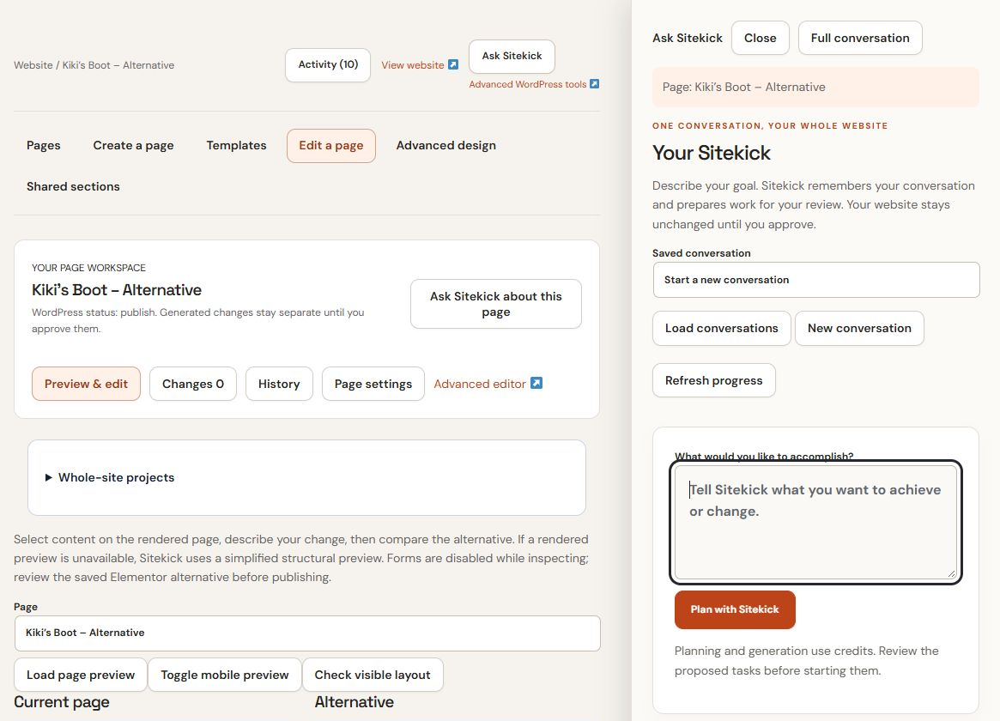

# Work with Your Sitekick

Sign in at [Sitekick CMS](https://cms.sitekick.ai/), open the website you want to work on, and choose **Ask Sitekick**. The same **Your Sitekick** conversation is available in the side panel and through **Full conversation** or **Plan a project**. Closing the panel or moving between workspace sections does not create a new conversation.

## Start or continue a conversation

*Production demo capture, 23 October 2026: the panel is open beside the page workspace, with no saved conversation loaded. Account details are cropped. No prompt or generation was submitted for this capture.*

1. Choose **New conversation** for a separate goal, or **Load conversations** and select an entry under **Saved conversation** to resume saved work.
2. Describe the result you want under **What would you like to accomplish?**, then choose **Plan with Sitekick**.
3. Wait for the saved planning job. Use **Refresh progress** to check it. Answer any questions before approving tasks.
4. Read each task's instructions, target and indicative credit reservation. Choose **Approve and prepare draft** for a content task or **Approve guided task** for a supported configuration task.
5. Use **Review result here** or open **Activity** to inspect the result. Preparing a draft and approving its application are separate steps.

For example: “On the Services page, shorten the introduction and make the consultation button clearer. Keep our service names and prices unchanged.” Check the proposed target before starting the task.

Planning and generation use credits. Estimates are indicative; the actual request can change the reservation. An unavailable estimate needs valid configuration before generation can start. Check **Usage** and your account's current allowance rather than assuming requests are unlimited.

## Understand the context

Conversations belong to the signed-in author within the current website. A conversation is not shared memory across every website or every person on your account. Load it again after returning to the website; do not assume a fresh login automatically resumes it.

The Ask Sitekick panel shows its current context, such as a page, selected element, article or workspace section. In the panel, that context accompanies your next request. In the full conversation, name the intended page or item explicitly. Moving to another page does not retarget a task already started. Review the target shown in the proposal and saved job.

Saved business information, recent conversation turns and approved decisions help guide proposals. This is bounded context, so repeat essential constraints in a new conversation. Use **Remember an approved decision** → **Save decision** for a fact such as “Use consultation requests as our main visitor action.” Saving a decision does not apply an edit or approve future publication.

## Choose a practical task

| Goal | What to ask or open | What to review |
| --- | --- | --- |
| Improve a page | Name the page, the text to change and facts to preserve | Proposed text and the saved page preview |
| Prepare an article | Give the topic, audience and approved business facts | Title, body, links and publication settings |
| Change an image or layout | Open the page's visual workspace and select the element | Current and alternative views, then the actual saved preview |
| Adjust SEO, navigation or contact setup | Describe the goal and follow the supported guided task | Exact settings, permissions and any separate activation step |
| Build a coordinated website | Open **Whole-site projects** | Blueprint, generation estimate, private candidate and release approval |

A broad conversation can propose individual page tasks. For a coordinated release, follow [Whole-site projects](whole-site-projects.md). Product tasks prepare copy; they do not authorize arbitrary stock, price or checkout changes. Available guided tasks depend on installed features and permissions. Sitekick does not promise arbitrary plugin installation.

Continue with [Review, publish and recover changes](review-publish-and-recover.md), or see [Saved work and queue troubleshooting](../i-encountered-problems-how-do-i-fix-them/saved-work-and-queues.md).
